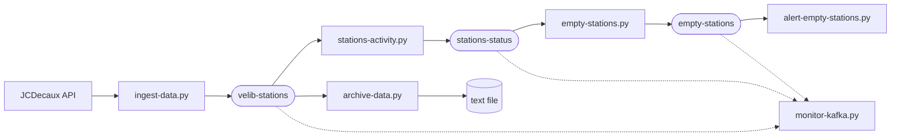

# Velib live usage tracking with Kafka

A small streaming pipeline that follows bike-sharing stations in real time. It polls the [JCDecaux self-service bike API](https://developer.jcdecaux.com) every 10 seconds, pushes the station data through Apache Kafka, and detects the moments when a station runs out of bikes or gets bikes back.

The API covers the JCDecaux networks of many cities (Lyon, Toulouse, Nantes, Dublin, Brussels and more), so the pipeline tracks all of them at once.

## How it works

Each script is an independent process. They only communicate through Kafka topics, so any of them can be stopped, restarted or replaced without touching the others.



| Script | Reads from | Writes to | Role |
|---|---|---|---|
| `ingest-data.py` | JCDecaux API | `velib-stations` | Fetches every station every 10 seconds and publishes one message per station |
| `stations-activity.py` | `velib-stations` | `stations-status` | Keeps the last known state of each station and forwards it only when the number of bikes or free slots changes |
| `empty-stations.py` | `stations-status` | `empty-stations` | Publishes an event when a station becomes empty, and another when it stops being empty |
| `alert-empty-stations.py` | `empty-stations` | console | Prints an alert with the address and city of each station that just became empty |
| `archive-data.py` | `velib-stations` | `velib-stations-archive.txt` | Appends every raw message to a text file, one JSON document per line |
| `monitor-kafka.py` | all three topics | console | Prints topic, partition, offset and timestamp of every message flowing through the pipeline |

## Getting started

### Requirements

- Python 3 (developed with 3.14)
- A local Apache Kafka broker listening on `localhost:9092` (developed with Kafka 4.3.1)
- A free JCDecaux API key, available from [developer.jcdecaux.com](https://developer.jcdecaux.com)

### Install

```bash
python -m venv .venv
source .venv/bin/activate
pip install -r requirements.txt
export JCDECAUX_API_KEY=your_key_here
```

### Start Kafka and create the topics

From the Kafka directory:

```bash
KAFKA_CLUSTER_ID="$(bin/kafka-storage.sh random-uuid)"
bin/kafka-storage.sh format --standalone -t $KAFKA_CLUSTER_ID -c config/server.properties
bin/kafka-server-start.sh config/server.properties
```

In another terminal:

```bash
for topic in velib-stations stations-status empty-stations; do
  bin/kafka-topics.sh --create --bootstrap-server localhost:9092 \
    --replication-factor 1 --partitions 1 --topic $topic
done
```

### Run the pipeline

Run each script in its own terminal. Start the consumers first and the ingestion last: every consumer starts reading from the newest message, so anything published before it starts is not replayed.

```bash
python monitor-kafka.py
python alert-empty-stations.py
python empty-stations.py
python stations-activity.py
python archive-data.py
python ingest-data.py
```

## Example output

`monitor-kafka.py`:

```
velib-stations, 0, 572240, 2026-10-12 20:12:17.582000
velib-stations, 0, 572241, 2026-10-12 20:12:17.585000
```

`alert-empty-stations.py`:

```
Station <number> located at <address> in city of <city> is empty
```

## Notes

- Change detection is done in memory, so a station is only compared against what the script has seen since it started.
- `archive-data.py` keeps every message, including stations that did not change, so the archive grows by roughly 100 MB per hour. It is excluded from version control.
